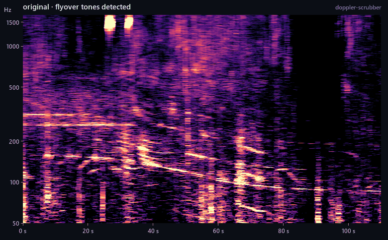

# doppler-scrubber

Remove aircraft Doppler tones from audio and video, so a recording cannot be
geolocated from them, without otherwise changing how it sounds.

Outdoor recordings carry faint tones from passing propeller aircraft (blade
pass and its harmonics, roughly 40–1700 Hz). The way each tone falls in
pitch as the aircraft passes depends on where the microphone was, and
matching that curve against public ADS-B flight history can place a
recording to within tens of metres
([dopplertrack](https://github.com/mjshiggins/dopplertrack) is an open
implementation). This package finds those tones and removes them.



## Usage

```bash
uv sync
uv run doppler-scrubber scan recording.mp4                 # list flyover tones, change nothing
uv run doppler-scrubber scrub recording.mp4 clean.mp4      # video stream copied, audio re-encoded once
uv run doppler-scrubber scrub recording.wav clean.flac --report report.json
```

The report lists the removed tracks with their fitted speed, distance and
time of closest approach, which is itself location-revealing: keep it private.

From Python, `scrub_file(src, out, ScrubConfig(processes=True))` uses the same
process pool as the CLI for the ridge fits; Windows and macOS start its workers
by re-importing your script, so call it under `if __name__ == "__main__":`.
Without `processes=True` everything runs in one process (threads only).

## How it works

1. **Find, two ways.** A 2 s STFT of a 4 kHz mono copy is whitened per
   frequency bin.
   - *Ridge tracks:* narrowband peaks are linked frame to frame, and a track
     is kept only if a straight-pass Doppler model (rest frequency, speed,
     closest-approach distance and time, with propagation delay, in closed
     form) fits it to a fraction of a hertz. Speech and music harmonics, hum,
     birdsong and noise chains fail that test. Each kept track is followed
     outward along its own model and refit, which joins fragments of one pass
     and follows faint tails.
   - *Matched-filter tracks:* the attacker's view. Every curve on a
     (speed, distance, CPA time, frequency) grid is scored by its ridge
     contrast integrated over a 4-minute window, and the best are polished
     with Nelder-Mead. This finds tones far too faint to show frame by frame,
     and anything scoring 2 dB or more is removed. The search is run again
     on the mean contrast of harmonics 1–4 (fundamentals up to 250 Hz): Doppler scales every harmonic by
     the same factor, so a stack whose lines are each too faint alone can
     stand out as a whole, and summing them is what an attacker would do.
2. **Remove.** Each line (the track times every ratio m/h, h ≤ 2, up to
   `fmax`) is heterodyned to 0 Hz with its tracked phase and low-passed to get
   the tone's complex amplitude, with small frequency errors corrected from
   the phase drift. Over the track's span the band is *replaced*: the
   amplitude is subtracted in full and independent noise at the level of side
   bands 4–6 Hz away is put back, shaped so the band's spectrum stays flat.
   The band then holds noise of the right level and no tone at all, whatever
   its SNR. It is about 1 Hz wide for a measured ridge and about 2.5 Hz for a
   matched-filter model. Harmonic lines other than the detected one are
   replaced only if, over the whole span, they hold clearly more power than
   their side bands. The edited band is then measured again and scaled, 2 s
   at a time, onto its target level (closed loop): tone left over is turned
   down, and a fill estimated too loud cannot stand out. The target never
   exceeds the band's own level, and a line is faded out where it sweeps
   outside `fmin`–`fmax`: a band only 1–2 Hz wide that comes out louder than
   the original is heard as a whistle.
3. **Repeat** detection on the cleaned audio (2 passes) to catch tones that
   were hidden under stronger ones.
4. **Protect steady lines.** Mains hum and machinery (bins loud at their 20th
   percentile) are taken out before scrubbing and are never edited, so a
   flyover crossing them leaves them as they were.
5. **Write.** The change is computed at 4 kHz, upsampled and added to the
   original full-rate samples, so content above ~1.9 kHz is untouched;
   nothing more than ~1.3 Hz from a removed line changes. All metadata
   (creation time, GPS, device tags, chapters), data streams such as camera
   telemetry, and cover art are dropped; the video stream is copied as is.
   Metadata inside the video bitstream itself (such as the SEI timecode or
   GPS some drones write) is not removed.

The matched-filter threshold is set per recording from a null: the same
search on the time-reversed spectrogram, where a real pass would sweep *up*,
which no aircraft does. It is kept within 2.0–2.5 dB.

The harmonic search, the closed-loop level check and the metadata
stripping follow [doppstop](https://github.com/EvanBoyar/doppstop), which
takes a broader approach to the same problem (also mains hum, decoys and
background resynthesis).

## Results

Tested against dopplertrack on its own two validation recordings, attacking the
scrubbed audio with the event fits from the *original* audio (more than a real
attacker would have).

| | Oyster Bay, NY (1 h) | SW Florida eagle cam (23 min clip) |
|---|---|---|
| dopplertrack `detect`, before | flyovers ranked 1 and 2 (15.7, 10.0) | flyovers ranked 1 and 3 (4.9, 3.7) |
| dopplertrack `detect`, after | gone; best curve anywhere 1.8–2.2 | gone; best curve anywhere 1.6–1.9 |
| known-point score of the true flight pair, before | 28.0 (the only pair) | 9.5, best wrong pair 6.7 |
| known-point score of the true flight pair, after (3 noise seeds) | 6.1–7.8 | 5.8–6.0, best wrong pair 4.8–5.1 |
| blind 200 m search, before (dopplertrack README) | true pair 1st of 328, 43 m off after refining | true pair 1st of 607 |
| blind 200 m search, after | not rerun for this version (0.1.0, where the true pair scored 7.9: 59th of 328, top guess 31 km away) | not run |
| tracks removed / time | 454 / 8.3 min | 117 / 4.6 min |
| change above 2 kHz | −54 dB re signal | −81 dB re signal |
| STFT cells changed by > 1 dB | 35 % | 9.3 % |

The cost depends on how busy the recording is. Oyster Bay, under New York
approach paths, is full of Doppler-shaped tones, and the scrubber replaces a
third of the 30–1700 Hz time-frequency cells there (with noise of the same
level); a quieter recording loses far less.

The noise put back into each band is random (seeded), and the known-point
scores move by about ±0.5 between seeds. With the location already known,
the true pair usually still scores a little above the best wrong one: the
scrub removes what a blind search needs, but an attacker checking a
suspected location keeps a weak confirmation. After scrubbing,
DOPPLERGEIST's `discover` still finds 3 faint events in Oyster Bay (18 in
the original) and 9 in the eagle cam clip (19 in the original). Every change is narrowband noise
traded for like noise, but listen to the result before relying on it.

## Examples

`examples/` holds 60 s before/after clips (FLAC, 48 kHz stereo) from the two
test recordings:

| clip | source | span |
|---|---|---|
| `oyster_A_original.flac` / `oyster_B_scrubbed.flac` | Oyster Bay, NY ([4CxVxuMVkMc](https://www.youtube.com/watch?v=4CxVxuMVkMc)) | 35:25–36:25 |
| `eaglecam_A_original.flac` / `eaglecam_B_scrubbed.flac` | SW Florida Eagle Cam ([zs2o5Rhlp5w](https://www.youtube.com/watch?v=zs2o5Rhlp5w)) | 5:37:00–5:38:00, around a flyover's closest approach |

Both locations are already public: the first is dopplertrack's own reference
recording and the second is the nest's published position.

## Limitations

- Only aircraft-like Doppler curves (straight passes, 20–250 m/s) are looked
  for. Turning aircraft are tracked by the ridge follower but fit worse.
- The threshold is tuned against dopplertrack's detector. A better detector
  could find fainter curves than this one removes.
- Where lines of two tracks run within ~6 Hz of each other, a strong tone can
  leak into the other line's level estimate, and that narrow band can come
  out up to ~10 dB louder (over 30 s) than it was.
- A suspected location can still be weakly confirmed (see Results).
- Speed: about 8 minutes per hour of audio on a busy recording (Oyster Bay,
  dual mono) and 5 minutes for 23 minutes of a quieter stereo one (eagle
  cam), at below-normal priority on a 10-core Intel i5-12600K. The search
  kernels are compiled with Numba (the first run compiles and caches them).

## Development

```bash
uv run pytest
```
